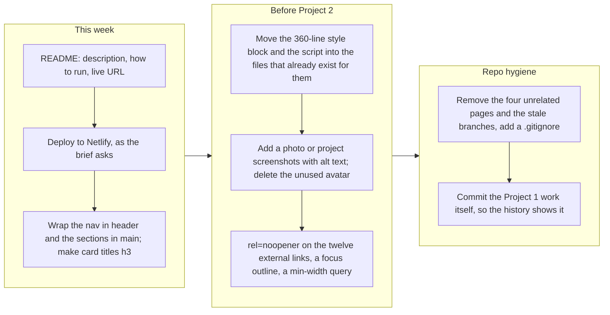

# Project 1: Static Foundations. Feedback for Hatem Alkhatib

**Student:** Hatem Alkhatib · **Course:** CSC 436, Fall 2026 · **Reviewed at commit:** [`235d8cb`](https://github.com/hkhatib005/Hatem/commit/235d8cba6d5428cb8033bd9faa67dca507bbfbb2)
**Repo:** https://github.com/hkhatib005/Hatem · **Live:** https://hkhatib005.github.io/Hatem/

> **How this review was made.** Your instructor reviewed this project with Claude (Anthropic's AI) as a second set of eyes. Claude cloned the repo, read the 702-line page including its embedded stylesheet and script, ran the W3C validator, loaded the live site in real viewports at 320, 375, 768 and 1280 pixels, opened and closed the mobile menu, scrolled to check the active-link highlight and the fade-in, compared the live site to the repo, and read all 32 commits and both stale branches. Every note below was read and approved by your instructor. **Your grade is posted in Brightspace, not here.** This file is the reasoning behind it.

## The short version

As a portfolio, this is one of the strongest pages in the class. The content is specific and real: a named internship with a concrete system and a scale figure, a previous role, six projects with live links and repos, a press mention, certifications. The design is a coherent dark theme built on fifteen custom properties, with Flexbox for every row and Grid for the about, projects and programs sections. The mobile menu sets `aria-expanded` correctly and closes itself when you pick a link. The active-link highlight and the fade-in both work. Nothing scrolls sideways at 375, 768 or 1280, and the validator finds one error, which is a favicon.

As a submission for this assignment, it has a different problem, and it is the one to talk about first. The repository's last commit is July 19. The course started in late August and Project 1 was due September 15. There is no commit in that window, so the history does not show this project being built; it shows a portfolio that already existed. The brief's repository requirements are written around the history of the assignment itself. The README is a title and the single word "Profolio." The site is on GitHub Pages where the brief specifies Netlify. And the repo carries four unrelated standalone pages from May, an unused 311 KB image, two stale branches and five commits that only edit a CNAME file.

In the code, the gaps are about structure rather than looks. The nav is not inside a `header`, the seven sections are not inside a `main`, and every company name, job title and project name is a `div` instead of a heading, so the page's outline is one `h1` and six `h2`s with nothing underneath. All 360 lines of CSS and all 47 lines of JavaScript are embedded in the HTML while a `styles.css` and a `script.js` sit in the repo unused by this page. There are no images at all. Twelve links open new tabs without `rel="noopener"`. There is no focus style and no reduced-motion rule for the fade-ins.

## What the numbers looked like

| Check | Result |
|---|---|
| W3C HTML validator | 1 error (a space inside the data-URI favicon), 13 info notes |
| Horizontal scroll at 375 / 768 / 1280 px | None. At 320 px the page is 32 px wider than the screen |
| Heading order | One h1, six h2, zero h3. Company, role and project names are `div`s |
| Semantic elements | nav (ul of 4), 7 section, footer. **No header, no main, no article** |
| Landmarks with names | 0 of 7 sections have `aria-label` or `aria-labelledby` |
| Layout | 19 Flexbox containers, 3 Grids (about 1 to 2, projects 2 to 3, programs 2 to 3), 2 with `auto-fit` |
| Media queries | 1, `max-width: 768px` (desktop-first) |
| Custom properties | 15 defined, 76 uses |
| `!important` | 5, all hero animation delays |
| Focus styles / reduced motion | 0 / 0 |
| Mobile menu | Opens with `aria-expanded="true"`, closes on link click; Escape does nothing |
| Active-link highlight | Works on scroll ("Experience" lit at 2,500 px); plain scroll listener, no throttle |
| Fade-in | IntersectionObserver on 4 card types, writes inline styles; runs regardless of motion preference |
| Console errors | 0 |
| Images | 0 on the page. `coursework-avatar.png` (549 by 652, 311 KB) is committed and unused |
| External links | 12 with `target="_blank"`, 0 with `rel="noopener"` |
| Where the CSS and JS live | 360 lines of CSS and 47 of JS inside `index.html`; `styles.css` and `script.js` are used only by `requirements.html` |
| Commits | 32, Feb 10 to Jul 19 2026. None after the course began |
| Other files | 4 standalone pages from May (slider, invoice calculator, mortgage calculator, requirements doc), none linked from the site |
| README | "# Hatem / Profolio" (1 of 4 items, with a typo) |
| Hosting | GitHub Pages from `main`; the brief specifies Netlify |
| Live vs repo | Identical |

---

## Semantic HTML

### What's working

- One `h1`, a real `<nav>` with a `<ul>` of links and a `<button>` for the toggle that carries `aria-label` and `aria-expanded` ([index.html#L381-L393](https://github.com/hkhatib005/Hatem/blob/235d8cba6d5428cb8033bd9faa67dca507bbfbb2/index.html#L381-L393)). Seven `<section>`s, each with an id the nav targets and an `h2`. A `<footer>`. `lang="en"`, a viewport tag, a description, Open Graph and Twitter tags, an inline SVG favicon. The experience bullets are a real `<ul>`.

### What to change

- **No `header`, no `main`.** The `<nav>` sits directly in `body` and so do the seven sections ([#L381](https://github.com/hkhatib005/Hatem/blob/235d8cba6d5428cb8033bd9faa67dca507bbfbb2/index.html#L381), [#L396](https://github.com/hkhatib005/Hatem/blob/235d8cba6d5428cb8033bd9faa67dca507bbfbb2/index.html#L396)). Wrap the nav in `<header>` and the sections in `<main>`. Those two elements are the landmarks a screen-reader user jumps between, and the brief lists both by name.
- **Every card title is a `div`.** "Walmart Global Tech," "Software Engineering Intern," "Dolphin Planner": all `<div class="exp-company">`, `<div class="exp-role">`, and so on ([#L463-L471](https://github.com/hkhatib005/Hatem/blob/235d8cba6d5428cb8033bd9faa67dca507bbfbb2/index.html#L463-L471)). The document outline is one `h1` and six `h2`s with nothing under them, so nobody can jump to a job or a project by heading. Make each card an `<article>` with an `<h3>` for its name. The look does not have to change; the classes stay.
- **The one validator error** ([#L14](https://github.com/hkhatib005/Hatem/blob/235d8cba6d5428cb8033bd9faa67dca507bbfbb2/index.html#L14)): the data-URI favicon contains raw spaces. Encode them as `%20` or move the SVG to a file.
- **Twelve links open new tabs with no `rel`** ([#L520-L522](https://github.com/hkhatib005/Hatem/blob/235d8cba6d5428cb8033bd9faa67dca507bbfbb2/index.html#L520-L522) and the rest). Add `rel="noopener noreferrer"` to every `target="_blank"`. It is a security default, and it is one find-and-replace.
- Small: `<strong style="color:#e6edf3">` on [line 525](https://github.com/hkhatib005/Hatem/blob/235d8cba6d5428cb8033bd9faa67dca507bbfbb2/index.html#L525) is the only inline style in the source. Give it a class.

  ```mermaid
  flowchart LR
    subgraph now["What a screen reader lists today"]
      direction TB
      a1["navigation"] ~~~ a2["7 regions, none named"]
      a2 ~~~ a3["contentinfo (footer)"]
      a3 ~~~ a4["Headings: one h1, six h2. Every company, role and project name is a div."]
    end
    subgraph after["After three edits"]
      direction TB
      b1["banner (header around the nav)"] ~~~ b2["main, holding the seven sections"]
      b2 ~~~ b3["contentinfo (footer)"]
      b3 ~~~ b4["Headings: h1, h2 per section, h3 per card. Jump to any job or project by heading."]
    end
    now --> after
  ```

## CSS layout

### What's working

- **A real token system.** Fifteen custom properties for the palette, borders and accents ([index.html#L20-L36](https://github.com/hkhatib005/Hatem/blob/235d8cba6d5428cb8033bd9faa67dca507bbfbb2/index.html#L20-L36)), used 76 times, so the GitHub-dark look is consistent from the nav to the footer. Nineteen Flexbox containers do the rows: nav, hero buttons, tag lists, card headers, project links. Three Grids do the two-dimensional work, and two of them are `repeat(auto-fit, minmax(...))`, so the project and program cards go from three columns to two to one without being told. Hover states on cards and buttons, a hero entrance animation, and `clamp()` on the display type.

### What to change

- **The stylesheet is in the wrong file.** All 360 lines of CSS are in a `<style>` block inside `index.html` ([#L18-L377](https://github.com/hkhatib005/Hatem/blob/235d8cba6d5428cb8033bd9faa67dca507bbfbb2/index.html#L18-L377)), and the 47 lines of JavaScript are in a `<script>` block at the bottom ([#L655-L701](https://github.com/hkhatib005/Hatem/blob/235d8cba6d5428cb8033bd9faa67dca507bbfbb2/index.html#L655-L701)). Meanwhile `styles.css` and `script.js` exist in the repo and are loaded only by `requirements.html`, a page the site never links to. The brief asks for separate CSS and JS files. Move the block into `styles.css`, the script into `script.js`, and link them. Same site, and the HTML drops from 702 lines to about 300.
- **Desktop-first, single breakpoint.** The one media query is `max-width: 768px` ([#L358](https://github.com/hkhatib005/Hatem/blob/235d8cba6d5428cb8033bd9faa67dca507bbfbb2/index.html#L358)). The brief asks for mobile-first: base rules for the phone, `min-width` queries adding columns. With two of your three grids already using `auto-fit`, the flip is mostly the nav and the about grid.
- **No focus styles, no reduced-motion rule.** Tab through the page and the links get the browser default ring, which is hard to see on `#080c10`. One `:focus-visible` rule fixes it. The hero animates in and the cards fade in for every visitor; wrap those in `@media (prefers-reduced-motion: no-preference)` or zero them in a `reduce` block. The five `!important`s ([#L318-L322](https://github.com/hkhatib005/Hatem/blob/235d8cba6d5428cb8033bd9faa67dca507bbfbb2/index.html#L318-L322)) are animation delays that would not need forcing if the base rule did not set a delay.

## Responsive design

### What's working

- No horizontal scroll at 375, 768 or 1280, measured in real viewports. The nav collapses to a hamburger, the about grid goes from two columns to one, the project and program grids reflow on their own, and the hero type scales with `clamp()`.

### What to change

- **Tablet is the phone layout.** With one breakpoint at 768, a 768-wide screen gets the hamburger and single-column about, the same as a phone. A `min-width: 600px` step for the about grid and the nav would use the width a tablet has.
- At 320 px the page is 32 px wider than the screen. The brief's bar is 375, so this is a note, not a deduction; the hero tags or the nav status pill are the likely cause.

## JavaScript interaction

### What's working

- **Three interactions, all verified, all vanilla.** The menu toggle flips a class and `aria-expanded` from the same boolean and closes on any link click ([index.html#L657-L670](https://github.com/hkhatib005/Hatem/blob/235d8cba6d5428cb8033bd9faa67dca507bbfbb2/index.html#L657-L670)), which is the cleanest toggle pattern in the class. The active-link highlight compares scroll position to section offsets and moves an `active` class ([#L673-L684](https://github.com/hkhatib005/Hatem/blob/235d8cba6d5428cb8033bd9faa67dca507bbfbb2/index.html#L673-L684)); Claude scrolled to 2,500 px and "Experience" lit up. The fade-in uses an IntersectionObserver rather than a scroll handler ([#L686-L700](https://github.com/hkhatib005/Hatem/blob/235d8cba6d5428cb8033bd9faa67dca507bbfbb2/index.html#L686-L700)). Zero console errors.

### What to change

- **The scroll listener runs on every scroll event** with no throttle, and it never `unobserve`s. Wrap the highlight in `requestAnimationFrame`, or better, use a second IntersectionObserver for it too; you already have the pattern.
- **The fade-in writes inline styles** (`opacity`, `transform`, `transition`) onto every card at load. Toggle a class instead and keep the styling in CSS, which also lets a reduced-motion rule switch it off; today the animation runs for everyone, and there is no `matchMedia` check.
- Small: Escape does not close the open menu, and focus is not returned to the button. Four lines.

## Repository and deployment

### What's working

- The live site is public and matches the repo byte for byte. Most of the later commit messages say what changed: "Strip generic template gimmicks from portfolio," "Fix stat inaccuracy, add DealBox and Park Ave Jewelers projects." Two branches were merged through pull requests, which is a good habit.

### What to change

- **The history does not show this project being built.** All 32 commits fall between February 10 and July 19, 2026. The course began in late August and the project was due September 15; there is no commit in that window. The brief's repository category is written around the history of the assignment: a README for it, commits that show it developing, a deploy of it. Your instructor will decide how the pre-existing work is treated; that is not a call this review makes. What the review can say is that if Project 1 work was done, it is not in the repo, and the fix for next time is to commit the work as it happens.

  ```mermaid
  flowchart LR
    subgraph repo["When the commits happened"]
      direction TB
      r1["Feb 10: initial upload"] --> r2["Mar 6: files via upload, then deleted and re-uploaded"]
      r2 --> r3["May 4 and 18: four standalone pages added: slider, two calculators, a requirements doc"]
      r3 --> r4["Jun 13 to 26: index.html rewritten, two branches merged"]
      r4 --> r5["Jul 19: projects added, template gimmicks stripped, five CNAME commits"]
    end
    subgraph course["When the course ran"]
      direction TB
      c1["Late Aug: CSC 436 starts"] --> c2["Sep 15: Project 1 due"]
      c2 --> c3["Sep 28: submitted. Zero commits in this window."]
    end
    repo --> course
  ```

- **The README is one word** ([README.md](https://github.com/hkhatib005/Hatem/blob/235d8cba6d5428cb8033bd9faa67dca507bbfbb2/README.md)): "Profolio." The brief asks for a title, a description, how to run it, and the live URL. Ten minutes.
- **The brief says Netlify.** It names Netlify as the deploy target three times. The site is on GitHub Pages, which works and is public, so this is a small deduction, but connecting the repo to Netlify is a five-minute task the rest of the semester builds on.
- **Housekeeping.** Four unrelated standalone pages from May (`image-slider.html`, `invoice-calculator.html`, `mortgage-calculator.html`, `requirements.html`) sit in the repo and nothing links to them. `coursework-avatar.png` is 311 KB and used nowhere. Two branches (`more-improvments`, `portfolio-improvements`) are fully merged and should be deleted. Five of the last six commits only touch a `CNAME` file that was then removed. There is no `.gitignore`. Commits are signed by three different identities. A recruiter who clicks through to this repo from the portfolio sees all of that before they see the site.

## Content and polish

### What's working

- This is the best content in the class. Every claim is specific: what was built, at what scale, with which tools, and where to see it. Six projects with both live links and repos. A press mention with a link. Certifications named. An "available for roles" status, contact links, and Open Graph tags so the page previews correctly when shared. The writing is confident and short. The design is consistent, the favicon is custom, and the footer is signed.

### What to change

- **There are no images.** The brief asks for real images with alt text, and the page has none: no photo, no project screenshots, no logos. The avatar you committed in June was removed from the page two days later and is still in the repo. One photo in the hero and a screenshot per project card would cover it and would make the projects section far more convincing than tag pills alone.
- Small: the four hidden pages from May carry their own titles with your name in them and are reachable by URL. Either link them from the portfolio as coursework or remove them.

---

## Your next moves



1. **Do the paperwork.** README, Netlify, `header` and `main`, `h3` on the cards. Under an hour, and it is most of what the rubric is missing.
2. **Put the CSS and JS in their files, and add images.** The files already exist. A photo and six screenshots with alt text.
3. **Clean the repo.** Remove what is not the portfolio, delete merged branches, add a `.gitignore`, and from now on commit the coursework as you do it.

*This review lives in a pull request on your repo. It only adds files under `feedback/` and does not touch your code. Merge it, close it, or just read it. Your grade is in Brightspace. Questions go to office hours or the Brightspace board. The portfolio is already doing its job, Hatem; the assignment asks for the scaffolding around it.*
